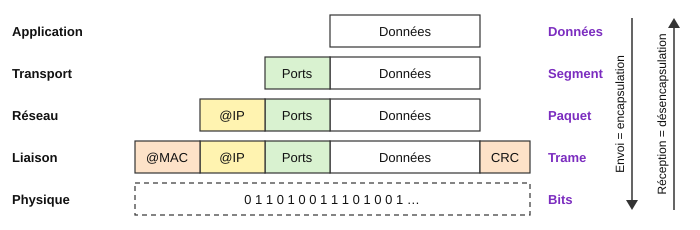
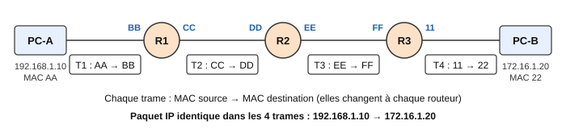
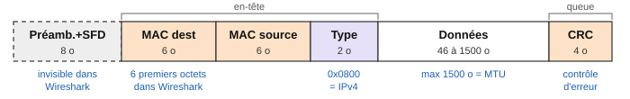

**LE JEUNE Louis — UID : ____________**
Réseaux Informatiques 1 — Chapitre 2 : Modèles des réseaux, couches physique et liaison — 07/10/2026

---

## ===== RECTO =====

### Partie 1 — Modèles OSI et TCP/IP

**Encapsulation.** Encapsuler, c'est placer un message dans un autre format, comme une lettre que l'on met dans une enveloppe. Pour envoyer un message, il faut **4 adresses**. Dans la lettre, « Bonjour Florian » correspond à l'**@IP de destination** et la signature « Youssef » à l'**@IP source** : ce sont les adresses logiques, placées dans le **paquet**. Sur l'enveloppe, on écrit l'**@MAC de destination** et l'**@MAC source** : ce sont les adresses physiques, placées dans la **trame**. Un message peut être envoyé à une seule machine (**unicast**), à un groupe (**multicast**) ou à tout le monde (**broadcast**).

**Modèles en couches** ★. On découpe la communication en couches pour qu'une modification reste locale à sa couche, et pour que tous les constructeurs puissent communiquer entre eux (interopérabilité). Le modèle OSI est théorique, le modèle TCP/IP est celui utilisé en pratique. Les numéros de couche n'existent que dans l'OSI.

| N° | OSI | TCP/IP | PDU |
|---|---|---|---|
| 7-6-5 | Application, Présentation, Session | Application | Données |
| 4 | Transport | Transport | Segment |
| 3 | Réseau | Réseau | Paquet |
| 2 | Liaison de données | Liaison | Trame |
| 1 | Physique | Physique | Bits |

À l'envoi, chaque couche ajoute son en-tête ; à la réception, on les retire (désencapsulation).

**Rôle des couches.** La couche **physique** transporte des bits d'un point A à un point B sans comprendre leur contenu. La couche **liaison** transmet les trames d'un saut au saut suivant sur le lien local grâce aux **@MAC** (pour nous, un saut est un routeur). La couche **réseau** transmet les paquets de bout en bout, de la source originale à la destination finale, grâce aux **@IP**, et s'occupe du routage. La couche **transport** identifie les différents flux grâce aux **numéros de port**, indépendamment de l'IP et de la MAC : c'est ce qui permet d'avoir YouTube et Netflix ouverts en même temps. On y trouve **UDP** pour la rapidité (jeux, live) et **TCP** pour la fiabilité (mails). La couche **session** identifie l'utilisateur sans dépendre des adresses (on reste connecté à Instagram). La **présentation** gère le formatage, la compression et le chiffrement, et l'**application** sert d'interface avec l'utilisateur.
Le hub travaille sur la couche 1. Le switch travaille sur la couche 2 : il ne lit que les MAC et fait de la **commutation intra-réseau**. Le routeur travaille sur la couche 3 : il lit les MAC et les IP, et fait du **routage inter-réseau**.

**Combien de trames ?** ★ exam. 3 routeurs séparent PC-A et PC-B : il y a donc 4 réseaux et il faut **4 trames**. Les **@MAC changent à chaque routeur**, pas les IP.

---

## ===== VERSO =====

### Partie 2 — La couche physique

La **bande passante** est la capacité maximale théorique, comme le nombre de voies d'une autoroute. Le **débit** est ce qui passe réellement, il est toujours inférieur à la bande passante. Le **débit applicatif** correspond au débit sans la signalisation, et la **latence** est le temps mis par les données pour aller de A à B.

La **paire torsadée** (RJ-45, 100 m maximum) est torsadée pour réduire la diaphonie, c'est-à-dire un fil qui « entend » son voisin. L'UTP n'est pas blindé (c'est celui du TP), alors que le STP l'est. La **fibre** transporte de la lumière : elle est insensible aux interférences et va plus loin, mais elle coûte plus cher.

**Câbles** ★ TP. On utilise un câble **droit** entre deux équipements différents (PC–switch, switch–routeur) et un câble **croisé** entre deux équipements identiques, ainsi qu'entre un **PC et un routeur**. Le câble **rollover** sert à se brancher sur le port console. Les routeurs du TP n'ont pas d'auto-MDIX, il faut donc choisir le bon câble.

### Partie 3 — La couche liaison de données

Pour le **contrôle d'erreur**, le récepteur recalcule le **CRC** de la trame : s'il est différent de celui reçu, la trame est rejetée puis retransmise. Le **contrôle de flux** consiste à adapter son débit à la capacité de la destination et à la congestion du réseau.

**Trame Ethernet** ★. La **MTU** (Maximum Transmission Unit) est de 1500 octets de données.

L'**@MAC** fait 48 bits, soit 12 chiffres hexadécimaux. Elle est unique pour chaque interface : les 3 premiers octets identifient le fabricant et les 3 derniers sont uniques. Elle évite que tout le monde traite toutes les trames, comme avec un hub.
La MAC de destination dépend du mode d'envoi : FF-FF-FF-FF-FF-FF pour un broadcast et 00-00-00-00-00-00 quand elle est inconnue. En unicast, c'est la MAC du destinataire s'il est sur le même réseau, sinon celle de la **passerelle**.
**Réception** ★ : le PC lit d'abord la MAC de destination. Si c'est la sienne ou un broadcast, il accepte la trame et la désencapsule, sinon il la rejette.

### Partie 4 — Fonctionnement d'un switch

Le switch possède une **table MAC** qui associe chaque @MAC à un port. Elle est vide à l'allumage et se remplit grâce à deux phases :
1. **Apprentissage** : avec la MAC source, il note sur quel port se trouve l'émetteur (si elle est déjà connue, il remet sa minuterie à zéro).
2. **Transfert** : avec la MAC destination, il envoie la trame uniquement sur le bon port s'il la connaît, sinon sur tous les ports sauf celui d'arrivée.

*Exercice* : quand A envoie à B puis que B répond, S1 apprend A (Fa0/1) et B (Fa0/3), mais S2 n'apprend que A (Fa0/1), car la réponse ne passe pas par lui.
